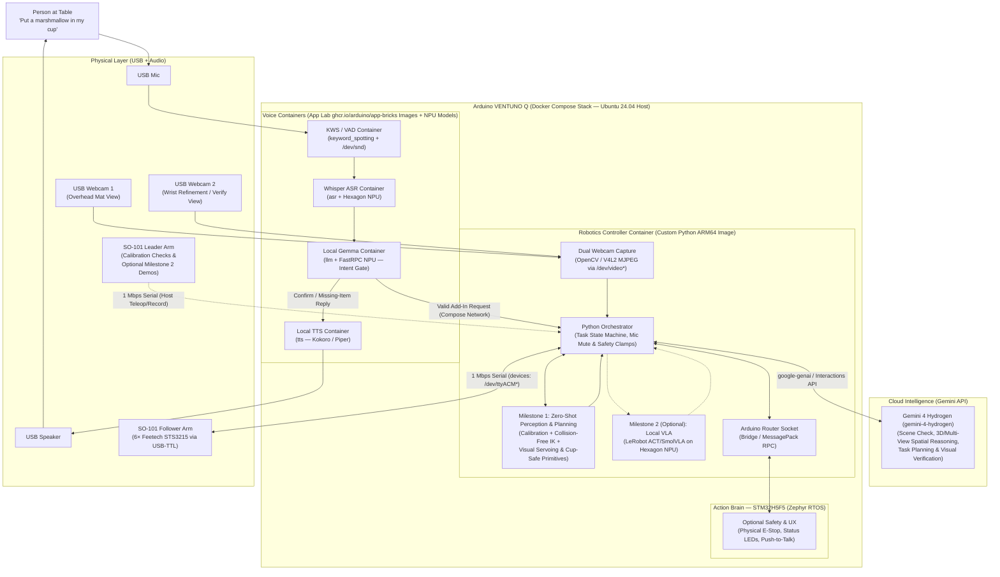

# SO-101 + Arduino VENTUNO Q + Gemini Robotics — Project Plan & Setup Guide

> **Status:** Milestone 1 Spec Locked — Zero-Shot Voice Drink Add-In Assistant  
> **Primary Goal:** Let people ask the robot out loud for a **sugar cube** or **marshmallow** and have the **SO-101** pick it up and drop it into a **cup — with zero training**.  
> **Hardware:** Arduino VENTUNO Q + SO-101 Leader & Follower Arms + 2× USB Webcams + USB Mic & Speaker (or Speakerphone)  
> **AI Stack:** **Local Edge Voice Front-End** (Standard `docker-compose.yml` reusing App Lab's NPU-optimized KWS, Whisper ASR, **Gemma** gatekeeper, & Kokoro/Piper TTS containers/models) -> **Milestone 1 Cloud Spatial Brain** (**Gemini 4 Hydrogen**, `gemini-4-hydrogen`, + Antigravity Robotics Plugin / SO-101 IK) | **Milestone 2 (Optional Hybrid Upgrade):** Local LeRobot VLA on the VENTUNO Q's 40-TOPS Hexagon NPU (or swap-in **Gemini Robotics 2.5** if partner access opens).

---

## 1. Milestone 1 — Zero-Shot Sugar Cube & Marshmallow Assistant

### User Experience Flow (Local Voice Front-End + Cloud Spatial Brain)
1. **Always-On Listening (Edge Container):** The **Keyword Spotting** service (`arduino:keyword_spotting` container image, wake word e.g. *"Hey Barista"* or *"Hey Arduino"*) + VAD listens locally on the USB mic without hitting the cloud.
2. **Local Transcription & Gemma Gatekeeper (Edge Containers):** Once triggered, the **Whisper ASR** container (`arduino:asr`) transcribes what was heard and passes it to the local **Gemma** container (`arduino:llm`, e.g., Gemma 4 E2B / Gemma 3 1B on the VENTUNO Q NPU):
   - If the utterance is background chatter or incomplete, Gemma stays idle (or asks a quick clarifying question).
   - If it hears a valid drink add-in request (e.g., *"Put two sugar cubes in my cup"* or *"Can I get a marshmallow?"*), Gemma outputs a structured request, **verbally confirms immediately** via the local **TTS** container (`arduino:tts` — Kokoro or Piper, e.g., *"Sure! Checking the table for a marshmallow and your cup."*), and fires the task to **Gemini 4 Hydrogen**.
   - *(Mic is briefly muted/gated while TTS speaks and while servos move so the robot doesn't re-trigger itself.)*
3. **Visual Reasoning & Planning (Cloud):** The **overhead webcam** captures the workspace and sends the image + parsed request to **Gemini 4 Hydrogen** (`gemini-4-hydrogen`, via `google-genai` / Interactions API):
   - Checks that a **cup** and the requested **sugar cube / marshmallow** are visible (if not, local TTS speaks the explanation aloud, e.g., *"I don't see a cup on the mat yet"* or *"Looks like we're out of marshmallows"*).
   - Plans the manipulation sequence, localizes the **target item** and **cup opening**, and dispatches the pick-and-drop action with item type (`sugar_cube` or `marshmallow`).
4. **Motion & Grip Execution (Edge):**
   - The VENTUNO Q executes **collision-free motion planning** (calibrated via the overhead mat / multi-view cameras) to approach the item safely.
   - *(Optional precision step)* The arm hovers above the item and uses the **wrist webcam** for visual servoing / fine-centering before descending.
   - The SO-101 Follower executes a **cup-safe pick-and-drop primitive** with an item-specific grip profile (firm-gentle for sugar cubes, extra-soft for marshmallows), clears the cup rim, releases, and returns home.
5. **Verification & Spoken Wrap-Up:** A post-drop camera check lets Gemini 4 Hydrogen confirm success (retrying once if an item slipped), and local TTS gives a brief confirmation (*"All set — enjoy your drink!"*).

### Physical & Workspace Design Tips (Important for Sugar Cubes & Marshmallows!)
- **Workspace Reach Sweet Spot:** Keep the sugar cubes, marshmallows, and cup zone within a **15–28 cm radius** directly in front of the SO-101 Follower base (SO-101 max reach is ~500 mm; staying well inside ~300 mm keeps 6-DOF IK smooth and well within joint/torque limits).
- **Flat Tray / Shallow Dish vs. Deep Bowl:** For zero-shot IK, start with sugar cubes and marshmallows spread in a **single layer on a shallow tray or contrasting dark matte mat** so white sugar cubes & marshmallows have crisp contrast for **Gemini 4 Hydrogen**. Deep, crowded bowls are much harder for pure IK (and a great reason to add a Milestone 2 VLA policy later).
- **Gripper Size, Compliance & Torque Tuning:**
  - Standard SO-101 parallel grippers open up to ~84 mm (plenty for 12–18 mm sugar cubes and 15–35 mm marshmallows). If your kit has angled lever jaws rather than parallel fingers, **mini marshmallows (~15 mm)** or a 3D-printed **compliant TPU/parallel finger mod** are far less likely to pop out on squeeze.
  - Add thin **food-safe silicone grip pads / sleeves** (or rubber fingertip tape) to PLA gripper jaws so sugar cubes don't slip and marshmallows don't stick or tear.
  - Use **item-specific grip profiles** via Feetech STS3215 goal position + torque limits:
    - `sugar_cube` (~12–18 mm, rigid): narrower close target, moderate torque limit.
    - `marshmallow` (~15–35 mm, soft): wider close target, low torque limit so it doesn't squish.
  - *(Hygiene & hot-drink note: if people drink from the cup, use washable food-grade silicone finger covers or wrapped items, and set the drop height **above** any liquid line so the gripper never touches coffee/cocoa.)*
- **Cup Rim Clearance (`z_transit`):** Always configure a safe transit height **above the tallest mug** (e.g., `cup_height + 5 cm`, typically ~15–16 cm above the table) before moving horizontally over the cup so the arm never knocks over a drink. Drop from ~2 cm above the rim center so marshmallows don't bounce off the lip.
- **2D-to-3D Without a Depth Camera (Parallax Correction):**
  - Tape **4 printed ArUco markers** at the corners of your workspace mat at known `(x, y)` coordinates in the SO-101 base frame (`z = 0`).
  - Mount the **overhead webcam high and roughly centered** (~55–75 cm above the mat) pointing straight down.
  - Compute planar homography `H` (`pixel -> table (x, y)` at `z = 0`). For elevated points (item pick height `z_item` and cup opening `z_cup`), apply simple pinhole parallax scaling using the camera's height `Z_cam` and optical center `(X_cam, Y_cam)` so tall cups still map accurately to their true opening center.

---

## 2. Model Landscape: Gemini 4 Hydrogen vs. Gemini Robotics-ER 2 vs. Gemini Robotics 2.5

| Model | Type | Role in This Project | Availability |
| :--- | :--- | :--- | :--- |
| **Gemini 4 Hydrogen** (`gemini-4-hydrogen`) | Fast Agentic & Spatial Reasoning Model | **Milestone 1 Core Brain (Recommended):** Incorporates and outperforms Gemini Robotics-ER 2 on spatial reasoning (ERQA, multi-view correspondence, 3D trajectory reasoning) at higher speed and lower cost. Drives robot bring-up, planning, visual feedback, and direct control loops. | **Public** via Gemini API / Interactions API (`google-genai`) & Google Antigravity. |
| **Gemini Robotics-ER 2** (`gemini-robotics-er-2-preview`) | Earlier Embodied Reasoning (**VLM**) | Predecessor spatial reasoning model—largely superseded by **Gemini 4 Hydrogen** for general robotics workflows. | **Public Developer Preview** via Gemini API. |
| **LeRobot Local Policy** (**ACT** / **SmolVLA**) | Edge **VLA** / Imitation Policy | **Milestone 2 Optional Upgrade:** If you later want learned dexterous skills (e.g., scooping from a deep jar or crowded bowl), record demos with your **Leader + Follower** pair and run locally on the VENTUNO Q's **40-TOPS Hexagon NPU** via ONNX/QNN. | **Open-source** (`huggingface/lerobot`), offline edge inference. |
| **Gemini Robotics 2.5** | Foundation **VLA** | End-to-end low-level VLA motor controller. Drop-in replacement for the skill executor if partner/trusted-tester API access opens up. | **Restricted** (enterprise hardware partners / waitlist; no public API yet). |

> **Workflow Accelerator & Access Note:** Google's **Antigravity Robotics Plugin** (`antigravity-plugins-official/plugin/robotics`, available to Google AI Pro / Ultra subscribers) pairs directly with `gemini-4-hydrogen` to streamline SO-101 bring-up, 3D perception, collision-free motion planning, visual servoing, and MuJoCo sim2real testing before deploying the runtime to the Arduino VENTUNO Q. Standalone Python scripts on the VENTUNO Q only need `google-genai` + a Gemini API key.
>
> **Important Modality & Latency Note for `gemini-4-hydrogen`:**
> - **Voice & Audio Flow:** `gemini-4-hydrogen` accepts audio/images/text in standard turns (no Live API / native audio output). Because our local Docker Compose voice containers (reusing App Lab's `keyword_spotting`, Whisper `asr`, local Gemma `llm`, and Kokoro/Piper `tts` images/models) handle speech locally on the VENTUNO Q, `gemini-4-hydrogen` receives clean parsed text + camera frames and stays focused purely on vision + spatial planning.
> - **Thinking Latency:** `gemini-4-hydrogen` supports `thinking_level` (`low`, `medium`, `high` [default], `xhigh`). Use `low` or `medium` for snappy pick-and-drop & verification turns so people aren't left waiting on extra reasoning tokens.
> - **On-Demand API Lifecycle (Zero Idle Streaming):** We do **not** stream video frames continuously to the cloud. While idle, zero API calls are made (only the local KWS/Whisper/Gemma stack listens). Each confirmed request triggers only **2–3 discrete single-frame turns**: (1) Plan & Locate from one stationary overhead snapshot, (optional) wrist fine-centering snapshot, and (2) Post-Drop Visual Verification after the arm clears the view.

---

## 3. System Architecture



### Runtime Deployment Topology (100% Standalone on VENTUNO Q — No PC Needed)
- **Dev Time vs. Runtime:** **Antigravity IDE + Robotics plugin + MuJoCo** run on your **computer** while developing and simulating. Once deployed, the **VENTUNO Q runs completely standalone** (making live HTTPS API calls to `gemini-4-hydrogen` over Wi-Fi/2.5GbE using `google-genai`—no laptop or MuJoCo needed on the board).
- **Standard Docker Compose + App Lab Optimized Models (Single Environment):**
  - **Minimal Host OS Footprint:** Keep the VENTUNO Q's Ubuntu 24.04 host clean (only `udev` rules, `v4l-utils`, Docker Engine/Compose, and `arduino-router`). All Python dependencies (`lerobot[feetech]`, `google-genai`, `opencv-contrib-python`, IK) live inside the **`robot-controller` Docker image**—so Phase 2 calibration, Phase 3 camera checks, and Phase 4 runtime all use the exact same environment.
  - **Persistent State via Bind Mounts:** Mount `./config` and `./.cache/lerobot:/root/.cache/huggingface/lerobot` into `robot-controller` so motor calibration and ArUco mat calibration saved during Phases 2–3 persist automatically for Phase 4.
  - **Seed Once via App Lab:** Run the official App Lab *"Local AI Voice Assistant"* once on the VENTUNO Q. This pulls the pre-built `aarch64` `ghcr.io/arduino/app-bricks/...` images, downloads the NPU-quantized Whisper/Gemma/TTS models, and writes App Lab's generated compose file (typically under `.cache/app-compose.yaml`) containing the exact Qualcomm **FastRPC** devices (e.g., `/dev/fastrpc-cdsp`), DSP/firmware mounts (`/usr/lib/dsp`, `/lib/firmware`), and `ADSP_LIBRARY_PATH` environment variables.
  - **Own `docker-compose.yml` for Everything:** Copy those pre-wired voice/NPU services into this repo's `docker-compose.yml` and pair them with `robot-controller` (`devices:` passing `/dev/video*` and the SO-101 serial ports directly—no App Lab container serial workaround or host `arm_server.py` needed!).
  - **Serial Device Caveat in Docker:** Docker's `devices:` resolves device major/minor numbers at container start—avoid mapping unstable symlinks if unplugging/replugging, or pass `/dev/ttyACM*` explicitly for locked-down runs (use temporary privileged/host-`/dev` mode only during interactive `lerobot-find-port` cable-swap steps) and restart the controller container if a cable is replugged. Add `restart: unless-stopped` so the whole robot boots cleanly headless.

---

## 4. Hardware Inventory, Specs & Wiring Plan

### 4.1 Compute: Arduino VENTUNO Q
- **AI Brain (MPU):** Qualcomm Dragonwing™ IQ8 (QCS8275) octa-core Kryo CPU, Adreno 623 GPU, **Hexagon NPU (40 dense TOPS)**, Spectra 692 ISP, **Ubuntu 24.04 LTS** (`aarch64` / ARM64, Python 3.12.3 pre-installed).
- **Action Brain (MCU):** STMicroelectronics **STM32H5F5** (Arm Cortex-M33 @ 250 MHz, 4 MB Flash, 1.5 MB RAM) running Arduino Core on Zephyr RTOS.
- **Memory & Storage:** 16 GB LPDDR5 RAM, 64 GB eMMC onboard + M.2 M-key slot (2230 PCIe 4.0 ×4 NVMe — *data/models only, not a boot drive*).
- **Ports:** **2× USB 3.0 Type-A**, **1× USB-C** (host/device, DP Alt Mode, USB-PD), HDMI Type-A, 2.5 GbE RJ45, Wi-Fi 6 / BT 5.3, 3× MIPI-CSI, CAN-FD, Qwiic, UNO shield & 40-pin RPi HAT headers.
- **Power (Critical Gotcha):**
  > ⚠️ **Standard 5V USB ports will NOT boot the VENTUNO Q.** Its USB-PD controller (CYPD6129) requires a PD profile above 5V (9–20V, e.g., the official **65W USB-C PD supply**), or **7–24 VDC (≥ 3 A)** via the 5.5×2.1 mm barrel jack / screw terminal (the 65W kit includes a USB-C-to-barrel adapter). If you plug the USB-C port into a host PC for data/App Lab, power the board via the barrel jack or screw terminal. Peak SoM draw is ~23–25W under full AI load.

### 4.2 USB Port, Audio & Bandwidth Topology (Important!)
With **2× USB webcams + SO-101 Follower (+ optional Leader) + USB Mic & Speaker**, you have **5–6 USB peripherals** and **2× USB 3.0 Type-A ports** on the VENTUNO Q:

- **Use a Powered USB 3.0 Hub** so the VENTUNO Q's USB rails don't brown out.
- **Recommended USB layout:**
  - **VENTUNO Q Power:** Prefer the **12–24V barrel jack** (or screw terminal) so USB-C stays free.
  - **USB 3.0 Port A (Direct):** **Overhead Webcam** (high-resolution snapshot/stream isolation).
  - **USB 3.0 Port B (Powered USB 3.0 Hub):** **Wrist Webcam** + **SO-101 Follower USB-TTL** + **USB Speakerphone** (or separate USB Mic + USB Speaker; *a conference speakerphone with hardware AEC is ideal*) + **SO-101 Leader USB-TTL** (needed during calibration & Milestone 2 recording; can be unplugged during pure Milestone 1 voice demos).
- **Audio Hardware Note:** The bare VENTUNO Q has an onboard MAX98091 codec routed to the **JMISC** expansion header (not standard 3.5 mm jacks unless using an audio carrier), so **USB audio** (mic + speaker or speakerphone) is the cleanest plug-and-play choice.
- **UVC Bandwidth Tip:** Capture both webcams in **MJPEG** (`MJPG`) mode (`640×480 @ 30 FPS` live, or `1280×720` on-demand snapshot for Gemini pointing) instead of raw `YUYV`.

### 4.3 SO-101 Leader & Follower Arms
- **Follower Arm:** 6× Feetech STS3215 servos, all **1/345** gear ratio.
- **Leader Arm:** 6× Feetech STS3215 servos with mixed gear ratios (`1/191`, `1/345`, `1/191`, `1/147`, `1/147`, `1/147`).
- **Power Supply Status:** ✅ Separate, labeled power supplies on hand for **Leader** and **Follower** (always verify each label matches the arm plug before powering on; never power servos from VENTUNO Q USB).
- **Mounting:** Clamp the Follower arm rigidly to the same table/mat that holds the ArUco calibration markers so calibration never drifts.

### 4.4 Hardware Checklist
- [x] Arduino VENTUNO Q
- [x] SO-101 Leader Arm + SO-101 Follower Arm (with Feetech USB-TTL adapters & PSUs)
- [x] 2× USB Webcams (1× Overhead/Mat view, 1× Wrist view)
- [ ] Powered USB 3.0 Hub (4-port+ — ideally 7-port if keeping Leader, Follower, 2 cams, mic, and speaker all plugged in)
- [ ] USB Mic + USB Speaker (or single USB conference speakerphone with echo cancellation)
- [ ] Rigid desk clamp / baseplate + dark contrasting mat + 4 printed ArUco markers
- [ ] Overhead camera stand/arm (~55–75 cm directly above mat) + 3D-printed wrist cam mount
- [ ] Silicone/foam grip pads for SO-101 gripper fingers (for sugar cubes & marshmallows)
- [ ] Optional: Inline power switch / physical E-Stop button + M.2 2230 NVMe SSD (for Milestone 2 datasets)

---

## 5. Phased Setup & Bring-Up Runbook

### Phase 1 — Arduino VENTUNO Q Bring-Up & Container Build
1. Power the VENTUNO Q (65W USB-C PD or 7–24V barrel/terminal) and complete initial **Ubuntu 24.04** setup via **Arduino App Lab** (SBC mode with HDMI/keyboard/mouse, or PC-connected mode over USB-C while powered via barrel jack).
2. Verify system health and Docker over SSH:
   ```bash
   uname -a && lscpu && free -h && df -h
   systemctl status arduino-router
   docker --version && docker compose version
   ```
3. Add your user to `dialout`, `video`, `audio`, and `docker`, and install minimal host inspection tools (`v4l-utils`):
   ```bash
   sudo usermod -aG dialout,video,audio,docker $USER
   sudo apt-get update && sudo apt-get install -y v4l-utils
   # Log out and back in for group membership to take effect
   ```
4. Build the lean `robot-controller` ARM64 Docker image (`python:3.12-slim` + `feetech-servo-sdk` + `google-genai` + `opencv-contrib-python-headless` + NumPy IK—keeping the image ~500 MB instead of pulling 10+ GB of PyTorch/LeRobot deps for Milestone 1):
   ```bash
   cp -n .env.example .env
   docker compose build robot-controller
   ```
   *(If upgrading to Milestone 2 local VLA training/recording later, add LeRobot on top when needed.)*

---

### Phase 2 — SO-101 Motor IDs, Port Mapping & Calibration (Inside Container)
> **Tip:** Phases 2–3 use the `robot-tools` service (`profiles: ["tools"]` in `docker-compose.yml`), which mounts `/dev:/dev` with `privileged: true` so `docker compose run` works cleanly without `--privileged` or `--device` CLI flags (and without starting voice containers).

1. Identify USB serial ports (hot-plugged USB nodes appear live inside `robot-tools`):
   ```bash
   docker compose run --rm robot-tools python3 scripts/find_port.py
   ```
2. **Assign Motor IDs (Required for newly built kits):** Out-of-the-box STS3215 servos all share factory ID `1`. Unless your vendor pre-programmed them, run `scripts/setup_motors.py` inside `robot-tools` for your Follower arm (external servo PSU + USB connected, plugging servos one-by-one as prompted):
   ```bash
   docker compose run --rm robot-tools \
     python3 scripts/setup_motors.py --port /dev/ttyACM0
   ```
3. **Pin a stable port name (so `/dev/ttyACM0` doesn't turn into `ttyACM1` after a reboot):**
   - **Option A (Easiest — check built-in `/dev/serial/by-id/` first):** Run `ls -l /dev/serial/by-id/` on the VENTUNO Q host. If your Follower adapter shows a unique path there (e.g. `/dev/serial/by-id/usb-...-if00`), you can skip `udev` rules completely—just put that path in `.env` (`SO101_FOLLOWER_PORT=...`) and `docker-compose.yml` `devices:`.
   - **Option B (Custom `/dev/so101_follower` symlink via `udev`):**
     1. Inspect your adapter's IDs on the VENTUNO Q host (replace `ttyACM0` with the port from Step 1):
        ```bash
        udevadm info -q property -n /dev/ttyACM0 | grep -E "ID_VENDOR_ID|ID_MODEL_ID|ID_SERIAL_SHORT"
        ```
     2. Create `/etc/udev/rules.d/99-so101.rules` substituting your printed `ID_VENDOR_ID`, `ID_MODEL_ID`, and `ID_SERIAL_SHORT`:
        ```bash
        echo 'SUBSYSTEM=="tty", ENV{ID_VENDOR_ID}=="1a86", ENV{ID_MODEL_ID}=="55d3", ENV{ID_SERIAL_SHORT}=="YOUR_SERIAL", SYMLINK+="so101_follower", MODE="0666"' | sudo tee /etc/udev/rules.d/99-so101.rules
        ```
     3. Reload `udev` and verify the `/dev/so101_follower` symlink appears:
        ```bash
        sudo udevadm control --reload-rules && sudo udevadm trigger --subsystem-match=tty
        ls -l /dev/so101_follower
        ```
     *(In `docker-compose.yml` `devices:`, map the pinned path—e.g. `/dev/so101_follower:/dev/so101_follower`—and restart `robot-controller` if you unplug/replug the USB cable.)*
4. Calibrate the Follower arm inside `robot-tools` (saved to `./config/arm_calibration.yaml` via the mounted `./config` volume):
   ```bash
   docker compose run --rm robot-tools \
     python3 scripts/calibrate_arm.py --port /dev/so101_follower
   ```

---

### Phase 3 — Dual Webcam Setup & ArUco Mat Calibration (Inside Container)
1. List cameras & verify MJPEG modes on the host:
   ```bash
   v4l2-ctl --list-devices
   v4l2-ctl -d /dev/video0 --list-formats-ext
   ```
2. Pin stable camera paths via `/dev/v4l/by-id/` (or mapped `/dev/video*` nodes) in `config/hardware.yaml` and uncomment the verified `devices:` entries in `docker-compose.yml`.
3. Tape 4 printed ArUco markers (`DICT_4X4_50`, IDs `1–4`) to the 4 corners of the workspace mat, measure their `(x, y)` positions relative to the SO-101 Follower base origin, and run calibration inside `robot-tools` (saves `config/calibration.yaml` via the mounted `./config` volume):
   ```bash
   docker compose run --rm robot-tools python3 scripts/calibrate_mat.py
   ```
4. **Verify accuracy before live grasping:** Run a dry-run script in `robot-tools` where Gemini points to an item and the arm moves to `5 cm` **above** it (`z = 0.05 m`) without descending—visually confirm alignment within ~5 mm!
   ```bash
   docker compose run --rm robot-tools python3 scripts/test_gemini_point.py --move-pregrasp
   ```

---

### Phase 4 — Milestone 1: Local Voice Gatekeeper + `Gemini 4 Hydrogen` Execution Loop
1. Configure `.env` (never commit to git):
   ```env
   GEMINI_API_KEY=your_api_key_here
   ```
2. **Seed App Lab's NPU Voice Containers Once, Then Run via `docker-compose.yml`:**
   - First, run Arduino App Lab's *"Local AI Voice Assistant"* example once on the VENTUNO Q so it pulls the `ghcr.io/arduino/app-bricks/` images, downloads the optimized Whisper/Gemma/TTS models, and writes its generated compose file (`.cache/app-compose.yaml`).
   - Copy the `keyword_spotting`, `asr` (Whisper), `llm` (local **Gemma**, e.g., Gemma 4 E2B / Gemma 3 1B), and `tts` (Kokoro or Piper) service definitions—along with their `/dev/fastrpc-*`, `/usr/lib/dsp`, `/lib/firmware`, and model volume mounts—into this repo's `docker-compose.yml`.
   - Add our `robot-controller` container (passing `/dev/video*` and the SO-101 serial adapter via `devices:` and `GEMINI_API_KEY` via `.env`) on the same Docker Compose network.
   - Configure **Gemma's system prompt** as a strict gatekeeper/router returning short JSON:
     - If what Whisper heard is unrelated chatter or unintelligible -> `{"dispatch": false, "reply": ""}` (stays quiet and returns to listening).
     - If it's a valid request (e.g., *"one marshmallow in the cup"* or *"two sugar cubes"*) -> `{"dispatch": true, "reply": "Got it! Let me grab a marshmallow for your cup.", "request_text": "put one marshmallow in the cup"}`.
   - Play `reply` immediately via the local TTS container while `robot-controller` dispatches `request_text` + webcam frame asynchronously to **Gemini 4 Hydrogen** (`google-genai`) and drives the SO-101 directly.
   - **Anti-Loop Gate:** Suppress KWS/ASR listening while TTS is speaking and while the SO-101 servos are actively moving.
3. **Structured Gemini 4 Hydrogen (`gemini-4-hydrogen`) On-Demand Spatial Plan Contract (Called Only on Dispatch):**
   - **Call 1 (Plan & Locate):** Capture one stationary overhead frame + `request_text` from Gemma (plus optional wrist-cam fine-centering call if needed).
   - Set `thinking_level` to `"low"` or `"medium"` (instead of default `"high"`) and use structured JSON output (`response_schema`):
     ```json
     {
       "feasible": true,
       "spoken_reply": "All set — dropped a marshmallow in your cup!",
       "actions": [
         {
           "item_type": "marshmallow",
           "pick_point": [540, 312],
           "cup_point": [420, 680]
         }
       ]
     }
     ```
     *(If `feasible` is `false` — e.g., no cup visible or out of sugar cubes — speak `spoken_reply` aloud via the local TTS container. Coordinates use Gemini's normalized `[y, x]` `0–1000` range or direct 3D/tool parameters via the Antigravity Robotics plugin pipeline.)*
4. **Cup-Safe Pick-and-Drop Sequence (per action):**
   - `HOME` -> `PRE_GRASP` (`z = z_item + 6 cm`, gripper open) -> *(optional wrist-cam visual servoing)* -> `DESCEND` (`z = z_item`) -> `GRASP` (item-specific width & torque limit) -> `LIFT` (`z = z_transit`, above cup rim) -> `TRANSIT_OVER_CUP` (`x_cup, y_cup, z_transit`) -> `DROP` (descend slightly to `z_cup_rim + 2 cm`, open gripper) -> `RETRACT` -> `HOME`.
5. **Visual Verification & Spoken Wrap-Up:** Capture a fresh overhead frame and ask Gemini 4 Hydrogen whether the item was successfully placed (retry once if missed/dropped on the mat), then speak the final result via the local TTS container.

---

### Phase 5 — Milestone 2 (Optional Upgrade): Hybrid LeRobot VLA on Hexagon NPU
Once Milestone 1 works reliably, you can add learned policies for harder scenarios (e.g., picking from a deep jar or crowded bowl):
1. Record 30–50 demos per skill using your Leader + Follower + 2× webcams (`lerobot-record`).
2. Train **ACT** or **SmolVLA** on a GPU PC/cloud.
3. Export PyTorch -> **ONNX** -> compile/quantize via **Qualcomm QNN SDK** and run with ONNX Runtime `QNNExecutionProvider` on the VENTUNO Q Hexagon NPU.
4. Let **Gemini 4 Hydrogen** dynamically choose between zero-shot IK (clean tabletop) and a local VLA skill (cluttered bowl/jar).

---

### Phase 6 — Optional STM32H5F5 Safety & UX Polish
Install `pip install arduino-router-bridge` (`from arduino.router_bridge import Bridge`) and flash a sketch to the STM32H5F5 via **Arduino App Lab** using `Arduino_RouterBridge` for:
- Physical **E-Stop** button (cuts servo torque / power immediately)
- **Status LED ring / indicator** (Listening / Thinking / Picking / Dropping / Error)
- **Push-to-talk button** wired to STM32 GPIO that triggers audio capture over Bridge RPC!

---

## 6. Proposed Project Directory Structure

```text
so101-ventuno-q/
├── PLAN.md                   # This project plan & bring-up guide
├── docker-compose.yml        # Voice NPU containers (seeded from App Lab) + robot-controller
├── Dockerfile                # Lean ARM64 Python 3.12 image (feetech-servo-sdk + google-genai)
├── .env.example              # GEMINI_API_KEY + device config template
├── .gitignore
├── config/
│   ├── hardware.yaml         # Serial ports, camera paths, audio devices, gripper profiles
│   ├── arm_calibration.yaml  # Saved SO-101 Follower joint midpoints & tick bounds
│   └── calibration.yaml      # Saved ArUco homography & camera height
├── src/
│   ├── voice/
│   │   └── gatekeeper.py     # Calls local Whisper/Gemma/TTS containers + handles mic mute lock
│   ├── hardware/
│   │   ├── feetech_bus.py    # Pure-Python Feetech STS3215 serial bus driver (scservo_sdk)
│   │   ├── arm.py            # Safety-clamped SO-101 Follower controller
│   │   ├── cameras.py        # Dual USB webcam MJPEG reader (overhead + wrist)
│   │   └── mcu_bridge.py     # Optional STM32 Arduino Router Bridge RPC client
│   ├── brain/
│   │   └── gemini_hydrogen.py # Gemini 4 Hydrogen client (pointing, planning, verify)
│   ├── skills/
│   │   ├── calibration.py    # ArUco homography + height-parallax 2D->3D projection
│   │   ├── ik_controller.py  # SO-101 6-DOF IK + cup-safe pick-and-drop primitives
│   │   └── vla_runner.py     # Milestone 2: Local ONNX/QNN (Hexagon NPU) policy runner
│   └── main.py               # Orchestrator bridging Voice Gatekeeper -> Gemini 4 Hydrogen -> SO-101
├── firmware/
│   └── safety_ui/            # Optional STM32H5F5 sketch (E-Stop, LEDs, push-to-talk)
└── scripts/
    ├── find_port.py          # Interactive USB serial port finder
    ├── setup_motors.py       # Assign STS3215 motor IDs (1..6) & 1 Mbps baudrate
    ├── calibrate_arm.py      # Interactive SO-101 Follower midpoint & range calibration
    ├── calibrate_mat.py      # Interactive ArUco mat calibration helper
    └── test_gemini_point.py  # Smoke-test Gemini pointing & overlay points on webcam frame
```

---

## 7. Decisions Log

| # | Decision | Status | Value |
| :-: | :--- | :-: | :--- |
| 1 | **Primary Demo (Milestone 1)** | ✅ Locked | Zero-shot **Sugar Cube / Marshmallow -> Cup** assistant (no training required) |
| 2 | **AI Control Stack** | ✅ Locked | **M1:** **Gemini 4 Hydrogen** (`gemini-4-hydrogen`) + Antigravity Robotics plugin (perception, collision-free planning, visual servoing, MuJoCo sim2real) on VENTUNO Q; **M2 (optional):** Local LeRobot VLA on NPU |
| 3 | **SO-101 Arms** | ✅ Locked | **Leader + Follower pair** |
| 4 | **Cameras** | ✅ Locked | **2× USB Webcams** (1× overhead mat view + 1× wrist view) |
| 5 | **User Input Interface** | ✅ Locked | **Local Voice Stack** (App Lab NPU containers: KWS + Whisper ASR + local Gemma gatekeeper + Kokoro/Piper TTS) triggering Gemini 4 Hydrogen |
| 6 | **Servo Power Supplies** | ✅ Confirmed | Separate, labeled PSUs for **Leader** and **Follower** arms |
| 7 | **Runtime Packaging** | ✅ Locked | **Single Docker Compose workflow (`docker-compose.yml`)** for Phases 2–4: App Lab's `ghcr.io/arduino/app-bricks/` NPU voice containers + lean `feetech-servo-sdk` `robot-controller` container (persistent `./config` mounts + direct `devices:` passthrough) |

---

## 8. References

- **Gemini 4 Hydrogen for Robotics (Google Developers Blog):** https://developers.googleblog.com/gemini-hydrogen-for-robotics/
- **Arduino VENTUNO Q Documentation & Local AI Voice Assistant:** https://docs.arduino.cc/hardware/ventuno-q/
- **Hugging Face LeRobot (SO-101 Docs & CLI):** https://github.com/huggingface/lerobot
- **SmolVLA (Compact VLA in LeRobot):** https://huggingface.co/blog/smolvla
- **Gemini Robotics-ER + SO-101 Reference:** https://github.com/Ekumen-OS/GeminiRobotics-SO101
- **Google Gemini Robotics Pointing Sample:** https://github.com/google-gemini/robotics-pointing-sample
- **Google Gen AI Python SDK (`google-genai`):** https://github.com/googleapis/python-genai
