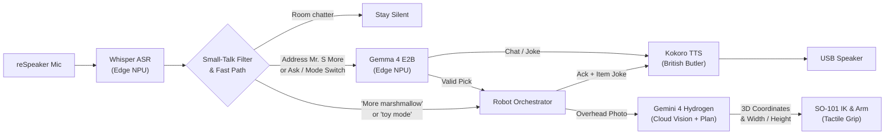

# Mr. S More — Marshmallow Butler ☕🤖

A tabletop robotics project powered by an **Arduino VENTUNO Q** and a **LeRobot SO-101** arm. Ask **Mr. S More** out loud for a marshmallow (or switch to **Toy Mode** for small desk toys), and he filters out room small talk, spots the item and cup, cracks an item-specific joke in a British butler voice while picking it up, drops it cleanly over the rim, and checks his work.

---

## How the Stack Flows



- **Local Edge Voice:** Whisper ASR + Gemma 4 E2B + Kokoro TTS run locally on the VENTUNO Q.
- **Cloud Spatial Brain:** **Gemini 4 Hydrogen** (`gemini-4-hydrogen`) is called only on demand when picking or verifying.
- **Cocoa vs. Toy Mode:** Food treats only by default; say *"switch to toy mode"* (or pass `--toy-mode`) for plushies, Legos, and small tabletop items.

---

## Quick Start

```bash
cp .env.example .env   # Add GEMINI_API_KEY and verify pinned by-id / ALSA CARD= devices
docker compose build robot-controller
docker compose up -d llamacpp-models-runner audio-analytics-runner kokoro-tts
docker compose run --rm robot-tools python3 -m src.main --mode voice
```

Use `--toy-mode` to start in Toy Mode, `--no-verify` to skip the post-drop check, or `--mode cli` for typed commands.

---

## Deep Docs & Guides

- **[PLAN.md](PLAN.md):** Detailed system architecture, full container/hardware flowchart, schemas, and phased setup
- **[UTILITIES.md](UTILITIES.md):** Servo/arm calibration, gripper tactile tuning, ArUco mat alignment, and device pinning
- **[config/hardware.yaml](config/hardware.yaml):** Link geometry, home pose, gripper profiles, and voice/ALSA settings
- **[requirements.txt](requirements.txt):** Python runtime and test dependencies
